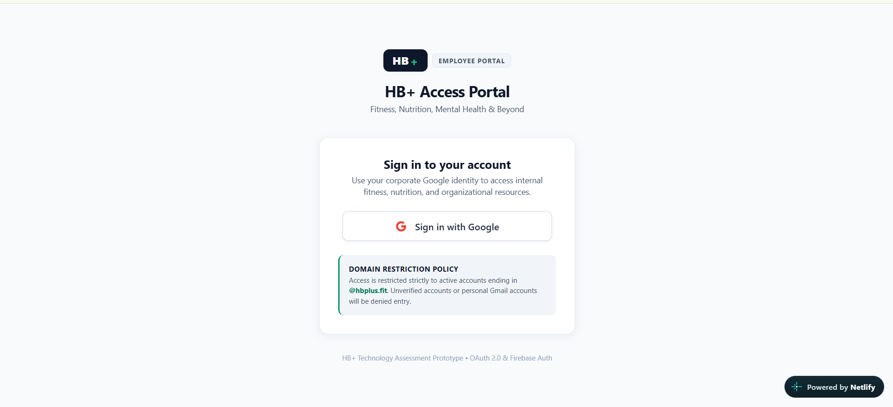
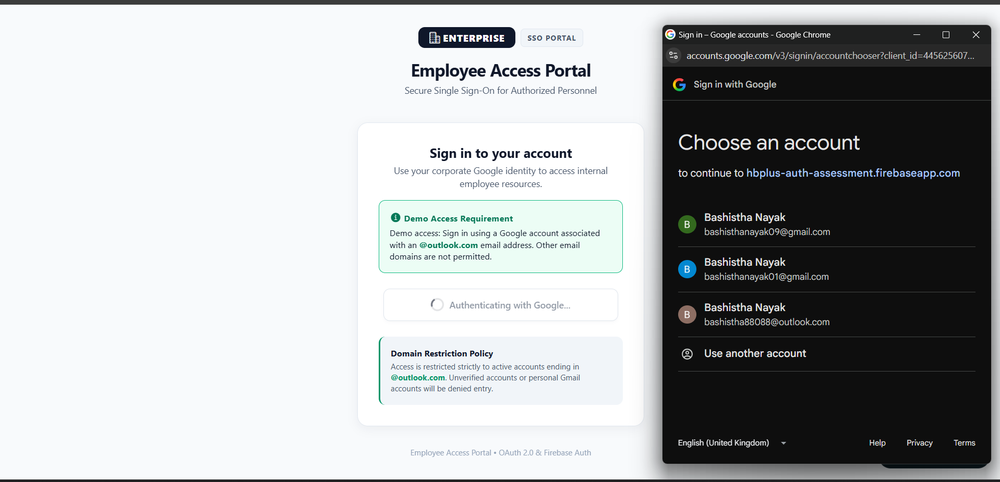
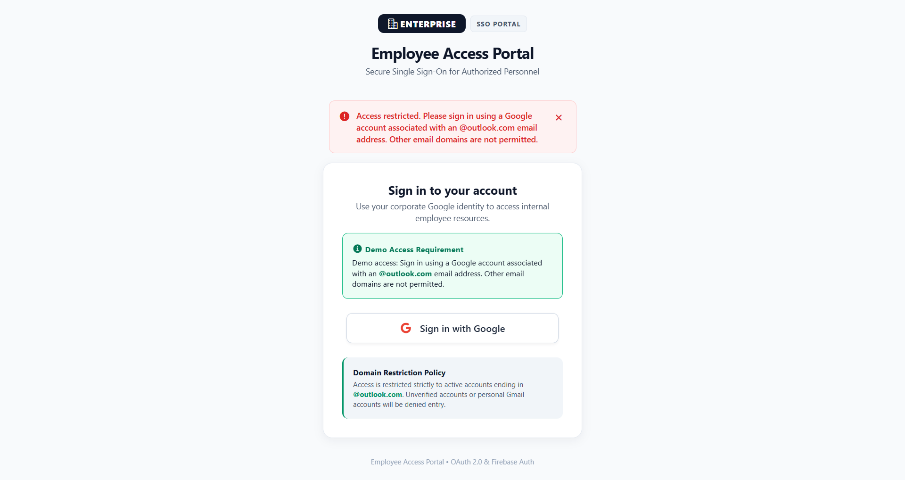
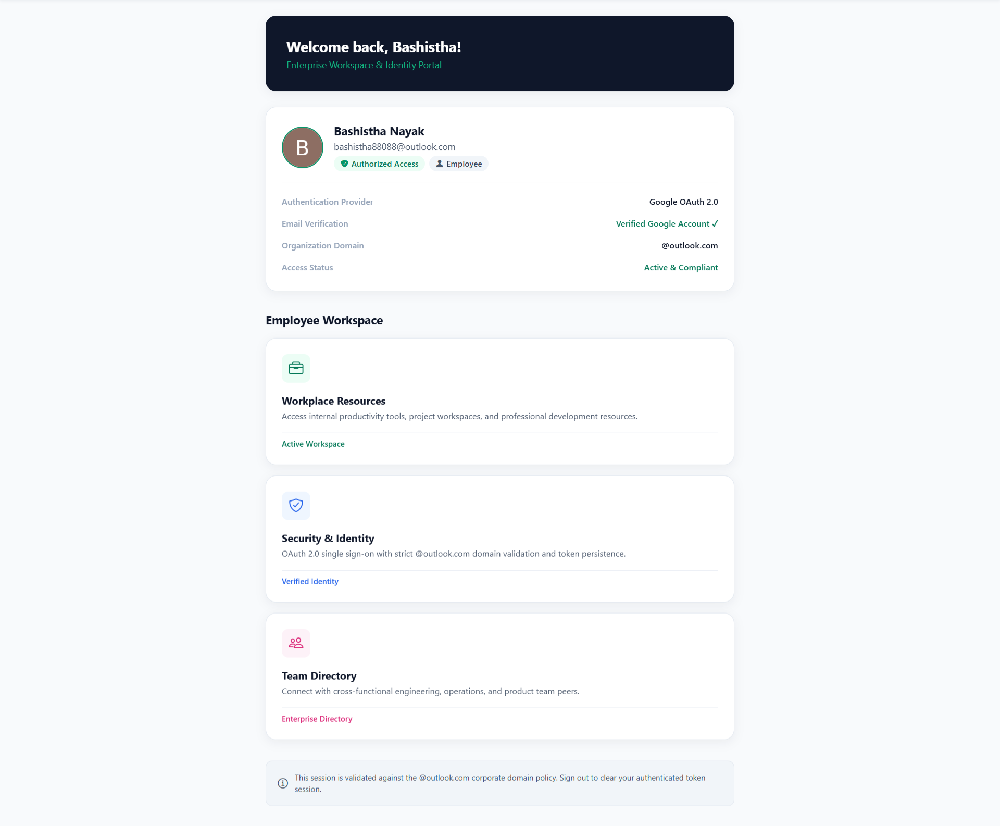
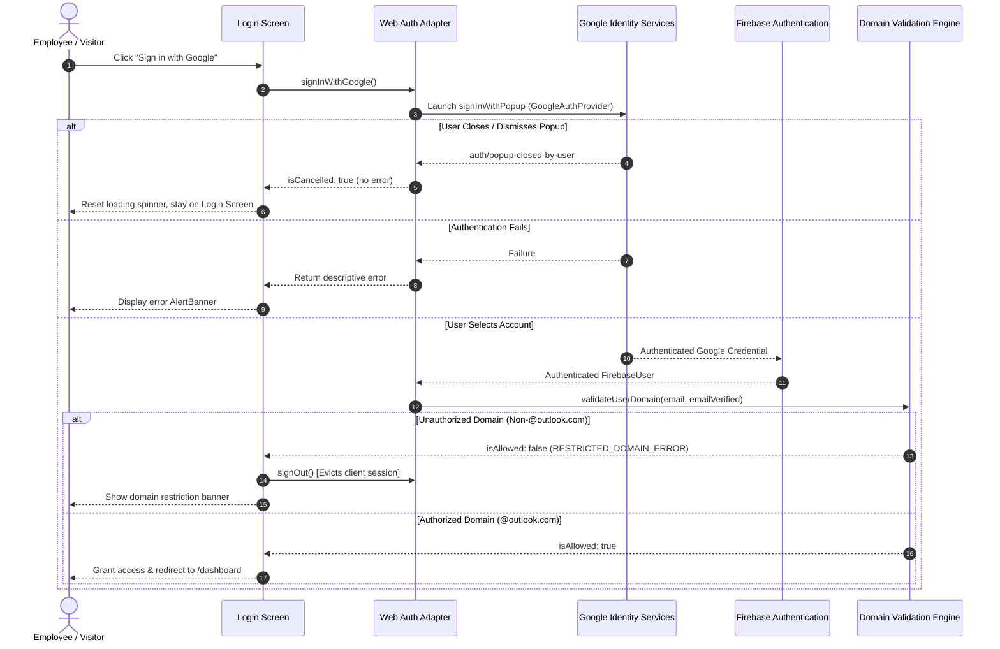

# Employee Access Portal

[](https://hbplus-auth-assessment.netlify.app)
[](https://github.com/BASHISTHANAYAK/hbplus-auth-assessment)
[](https://www.typescriptlang.org/)
[](https://necolas.github.io/react-native-web/)
[](https://expo.dev/)
[](https://firebase.google.com/)
[-brightgreen.svg)]()
[]()

> **Project:** Employee Access Portal (Developer Portfolio Showcase)  
> **Primary Technology:** React Native for Web, Expo Router, TypeScript, Firebase Authentication  
> **Allowed Domain Policy:** `@outlook.com`  
> **Demo Access Requirement:** Sign in using a Google account associated with an `@outlook.com` email address. Other email domains are not permitted.  
> **Live Web Application:** [https://hbplus-auth-assessment.netlify.app](https://hbplus-auth-assessment.netlify.app)  
> **GitHub Repository:** [https://github.com/BASHISTHANAYAK/hbplus-auth-assessment](https://github.com/BASHISTHANAYAK/hbplus-auth-assessment)  

---

## 1. Overview

The **Employee Access Portal** is a production-grade web authentication application showcasing enterprise Single Sign-On (SSO) built with **React Native for Web**, **Expo Router**, **TypeScript**, and **Firebase Authentication** (Google OAuth 2.0). 

The portal enforces a strict corporate domain restriction policy: only Google-authenticated accounts with a verified email ending in `@outlook.com` are granted access to internal employee workspace resources. Unauthorized email domains (such as personal `@gmail.com` accounts) are immediately rejected with descriptive security alerts and client session revocation.

### Tech Stack
* **Frontend:** React Native for Web (0.19), React (18.3), Expo (SDK 58)
* **Routing:** Expo Router (file-based navigation with layout guards)
* **Language:** TypeScript 5.x (Strict type-checking, 0 errors)
* **Authentication:** Firebase Authentication (v12.x) with Google OAuth 2.0 Popup Flow
* **Styling & Design:** React Native StyleSheet, responsive desktop/tablet layout, slate charcoal and emerald design system
* **Testing:** Jest, `ts-jest` (27 unit tests across 3 suites)
* **Deployment & Hosting:** Netlify (automated continuous deployment with SPA rewrites)

---

## 2. Screenshots / Application Preview

### 1. Login Page
The entrance page featuring the enterprise brand header, clear demo access instructions, and the Google Single Sign-On button.



---

### 2. Google Account Selection
The Google OAuth 2.0 authentication popup allowing the user to select an existing Google identity or register a new one.



---

### 3. Access Restricted
The defensive security response when a user authenticates with an unauthorized email domain (e.g. `@gmail.com`). The session is immediately revoked and an error banner is presented.



---

### 4. Authenticated Dashboard
The protected employee portal displayed upon authorized sign-in with an `@outlook.com` identity. Displays profile metadata, verified status, workspace resources, and sign-out controls.



---

## 3. Key Features & Authentication Flow

### 1. Strict Domain Restriction (`@outlook.com`)
* **Authorized Sign-In:** Users authenticating with a verified Google account registered with an `@outlook.com` email address are admitted to the protected dashboard (`/dashboard`).
* **Unauthorized Rejection:** Any non-`@outlook.com` email address is rejected with the exact security notice:  
  **`"Access restricted. Please sign in using a Google account associated with an @outlook.com email address. Other email domains are not permitted."`**
* **Instant Session Revocation:** Upon rejection, Firebase authentication tokens are evicted from client storage so no unauthorized session lingers.

### 2. Cancellation Handling
* If a user opens the Google Sign-In popup and dismisses or closes the window without completing authentication (`auth/popup-closed-by-user`), the application resets the loading indicator cleanly with no false or misleading error banners.

### 3. Route Protection & Direct URL Guards
* Navigation guards ensure unauthenticated visitors attempting to access `/dashboard` directly via URL are immediately redirected to `/login`.
* Active sessions persist across page refreshes via browser local persistence and automatically re-validate domain rules before rendering protected routes.

### 4. Authentication Architecture



---

## 4. Security Architecture & Considerations

> [!IMPORTANT]
> **Client-Side Domain Validation vs. Server-Side Authorization**
> 
> * **Client-Side Enforcement**: The domain check in [`src/utils/domainValidation.ts`](./src/utils/domainValidation.ts) provides navigation route guards, UI feedback, and client session revocation.
> * **Security Boundary Limitation**: Client-side domain validation runs on the user's browser and **does not** replace server-side authorization.
> * **Production Recommendation**: Any production backend or API must independently verify the Google ID token or Firebase Auth session cookie on the server (e.g., using the Firebase Admin SDK) and validate the `email` or `hd` (hosted domain) claim before returning sensitive organizational data.
> * **Database Rules**: Enterprise Cloud Firestore security rules enforcing `@outlook.com` at the database level are provided in [`firestore.rules`](./firestore.rules).
> * **Firestore Default State**: Cloud Firestore profile synchronization is **disabled by default** (`EXPO_PUBLIC_ENABLE_FIRESTORE=false`) to ensure clean execution without unhandled database connection errors.

---

## 5. Project Structure

```
hbplus-auth-assessment/
├── .env.example               # Template for environment variables
├── .gitignore                 # Git ignore rules (protects credentials and builds)
├── app.json                   # Expo web configuration & app metadata
├── firestore.rules            # Server-side Firestore security rules
├── jest.config.js             # Jest & ts-jest test runner configuration
├── netlify.toml               # Netlify build and routing configuration
├── package.json               # Dependencies and scripts
├── tsconfig.json              # TypeScript strict configuration
│
├── __tests__/                 # Comprehensive test suite (27 tests across 3 suites)
│   ├── authCancellation.test.ts # Google Sign-In cancellation & token handling (10 tests)
│   ├── domainValidation.test.ts # Domain validation, casing & security edge cases (11 tests)
│   └── firestoreService.test.ts # Firestore bypass guard & role assignment tests (6 tests)
│
├── public/
│   ├── _redirects             # Netlify SPA redirect fallback (/* /index.html 200)
│   └── Images/                # Web application showcase screenshots
│
└── src/
    ├── app/                   # Expo Router screens (file-based navigation)
    │   ├── _layout.tsx        # Root layout with SafeAreaProvider, AuthProvider, Stack
    │   ├── index.tsx          # Initial entry router with session detection
    │   ├── login.tsx          # Login screen with Google button, demo notices & alerts
    │   └── dashboard.tsx      # Protected dashboard screen with user profile & logout
    │
    ├── components/            # Reusable UI components
    │   ├── AlertBanner.tsx    # Accessible error/warning alert banner
    │   ├── BrandHeader.tsx    # Enterprise portal badge & typography
    │   ├── GoogleSignInButton.tsx # Branded Google button with loading spinner
    │   ├── LoadingScreen.tsx  # Centralized loading indicator
    │   ├── StatusBadge.tsx    # Color-coded status & role tags
    │   └── UserProfileCard.tsx# Profile card with photo, verified badge, domain details
    │
    ├── config/                # Environment & SDK configurations
    │   ├── authConfig.ts      # Domain policy, error strings, and display metadata
    │   ├── firebase.web.ts    # Web Firebase initialization
    │   └── firebase.ts        # Common fallback export
    │
    ├── context/
    │   └── AuthContext.tsx    # React Context managing session state, login, and logout
    │
    ├── services/              # Authentication & database services
    │   ├── authService.ts     # Google OAuth flow orchestration & session restoration
    │   ├── firestoreService.ts# Optional profile sync (disabled by default)
    │   └── authAdapter/       # Platform-specific auth adapter implementation
    │       ├── authAdapter.web.ts # Web Firebase popup authentication
    │       ├── authAdapter.ts     # TypeScript adapter interface
    │       └── types.ts           # Adapter interfaces & result types
    │
    ├── theme/                 # Design system
    │   ├── colors.ts          # Slate charcoal and emerald vitality palette
    │   ├── spacing.ts         # Paddings, margins, shadows, and border radii
    │   └── typography.ts      # Typography styles
    │
    ├── types/
    │   └── auth.ts            # TypeScript interfaces for users, roles, and auth states
    │
    └── utils/
        └── domainValidation.ts# Strict domain extraction and verification engine
```

---

## 6. Setup and Installation

### Prerequisites
* **Node.js**: v18.x, v20.x, or v22.x LTS (Recommended: v20 LTS)
* **Package Manager**: `npm`
* **Git**

### Installation Steps

```bash
# 1. Clone repository
git clone https://github.com/BASHISTHANAYAK/hbplus-auth-assessment.git
cd hbplus-auth-assessment

# 2. Install dependencies
npm install

# 3. Create .env file from template
cp .env.example .env
```

---

## 7. Environment Variables

Populate your `.env` file with your Firebase and OAuth configuration:

```ini
# Firebase Web Client Configuration (Firebase Console > Project Settings)
EXPO_PUBLIC_FIREBASE_API_KEY=AIzaSy...
EXPO_PUBLIC_FIREBASE_AUTH_DOMAIN=your-project.firebaseapp.com
EXPO_PUBLIC_FIREBASE_PROJECT_ID=your-project-id
EXPO_PUBLIC_FIREBASE_STORAGE_BUCKET=your-project-id.firebasestorage.app
EXPO_PUBLIC_FIREBASE_MESSAGING_SENDER_ID=123456789012
EXPO_PUBLIC_FIREBASE_APP_ID=1:123456789012:web:abcdef...

# Target Corporate Domain (Default: outlook.com)
EXPO_PUBLIC_ALLOWED_DOMAIN=outlook.com

# Optional Cloud Firestore toggle (Default: false)
EXPO_PUBLIC_ENABLE_FIRESTORE=false

# Optional Admin Email Whitelist
EXPO_PUBLIC_ADMIN_EMAILS=admin@outlook.com
```

---

## 8. Development & Testing Commands

```bash
# Start local web development server (opens at http://localhost:8081)
npm run web

# Run TypeScript type check (Strict Mode - 0 errors)
npm run lint

# Run Jest unit test suites (27 tests across 3 suites)
npm test

# Build production web bundle (Netlify export to dist/)
npm run build:web
```

---

## 9. Web Deployment (Netlify)

* **Live Deployment:** [https://hbplus-auth-assessment.netlify.app](https://hbplus-auth-assessment.netlify.app)
* **Hosting Platform:** Netlify (Continuous Deployment linked to GitHub `main` branch).
* **Build Command:** `npx expo export -p web` (configured in [`netlify.toml`](./netlify.toml)).
* **Publish Directory:** `dist`
* **SPA Routing:** Handled via [`public/_redirects`](./public/_redirects) mapping `/*` to `/index.html` with status `200`.
* **Firebase Authorized Domains:** `hbplus-auth-assessment.netlify.app` added to Firebase Console &rarr; Authentication &rarr; Settings &rarr; Authorized domains.

---

## 10. Verification & Testing Matrix

| Test Scenario | Scope / Environment | Expected Result | Status |
| :--- | :--- | :--- | :---: |
| **Domain Extraction & Security Edge Cases** | Unit Tests (`domainValidation.test.ts`) | Strict domain match, case insensitivity, subdomain spoofing rejection | ✅ **11/11 Passed** |
| **Firestore Bypass Guard** | Unit Tests (`firestoreService.test.ts`) | Skips Firestore when disabled, prevents `(default)` database warnings | ✅ **6/6 Passed** |
| **OAuth Cancellation & Token Distinctions** | Unit Tests (`authCancellation.test.ts`) | Distinguishes cancel vs token success vs true failure; clears sessions on reject | ✅ **10/10 Passed** |
| **TypeScript Strict Compilation** | Entire Project | Clean compilation with strict typechecking enabled | ✅ **0 Errors** (`tsc --noEmit`) |
| **Production Web Export** | Web (`dist/`) | Bundles 913 modules cleanly into production assets | ✅ **Passed** (`expo export -p web`) |
| **Unauthorized Domain (`@gmail.com`)** | Web Browser | Denies access, revokes session, displays required error banner | ✅ **Verified** |
| **Authorized Domain (`@outlook.com`)** | Web Browser | Grants access, establishes persistent session, navigates to dashboard | ✅ **Verified** |
| **User Cancellation (Close Popup)** | Web Browser | Returns cleanly to login, clears loading, no error shown | ✅ **Verified** |
| **Route Protection & Direct URL Guard** | Web Browser | Unauthenticated visitors to `/dashboard` redirected to `/login` | ✅ **Verified** |
| **Session Restoration** | Web Browser | Re-validates domain on reload before rendering dashboard | ✅ **Verified** |
| **Session Termination (Logout)** | Web Browser | Clears auth state, signs out from Firebase, redirects to `/login` | ✅ **Verified** |

---

## 11. Project Links

* **Live Web Application:** [https://hbplus-auth-assessment.netlify.app](https://hbplus-auth-assessment.netlify.app)
* **GitHub Repository:** [https://github.com/BASHISTHANAYAK/hbplus-auth-assessment](https://github.com/BASHISTHANAYAK/hbplus-auth-assessment)
