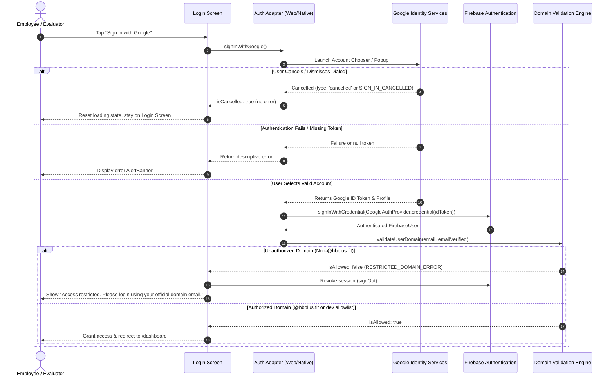

# HB+ Employee Access Portal — Cross-Platform Authentication App

[](https://hbplus-auth-assessment.netlify.app)
[](https://github.com/BASHISTHANAYAK/hbplus-auth-assessment)
[](https://www.typescriptlang.org/)
[](https://expo.dev/)
[](https://reactnative.dev/)
[-brightgreen.svg)]()
[-orange.svg)]()

> **Assessment Submission:** IT Intern Hiring Assessment  
> **Brand & Organization:** HB+ (Fitness, Nutrition, Mental Health & Beyond)  
> **Production Target Domain:** `@hbplus.fit`  
> **Live Web App:** [https://hbplus-auth-assessment.netlify.app](https://hbplus-auth-assessment.netlify.app)  
> **GitHub Repository:** [https://github.com/BASHISTHANAYAK/hbplus-auth-assessment](https://github.com/BASHISTHANAYAK/hbplus-auth-assessment)  

---

## 1. Executive Summary

The **HB+ Employee Access Portal** is a cross-platform mobile and web application built using **React Native**, **React Native for Web**, and **Expo Router**. It demonstrates a single, shared codebase architecture that enforces strict **Google OAuth 2.0 Single Sign-On (SSO)** restricted to authorized enterprise users.

### Core Behavior & Policy Enforcement
* **Authorized Employee (`employee@hbplus.fit`)**: Access granted to the protected internal dashboard displaying verified credentials, profile photo, identity metadata, and HB+ enterprise wellbeing resources.
* **Unauthorized External User (`someone@gmail.com` or other external domains)**: Access is immediately denied, client-side session tokens are revoked, and the user receives the required security alert:  
  **`"Access restricted. Please login using your official domain email."`**
* **User Cancellation**: If a user opens the Google Sign-In prompt and dismisses or cancels it without selecting an account, the application safely returns to the login screen, clears the loading indicator, and displays **no misleading error messages**.

---

## 2. Key Architecture & Cross-Platform Strategy

The application shares **100% of UI components, routing guards, theme systems, and domain validation logic** across Web, Android, and iOS.

```
                  ┌────────────────────────────────────────┐
                  │       Shared Presentation Layer        │
                  │   src/app (Expo Router Screens)        │
                  │   src/components (Cards, Buttons, ...) │
                  │   src/context/AuthContext.tsx          │
                  │   src/utils/domainValidation.ts        │
                  └───────────────────┬────────────────────┘
                                      │
                         src/services/authService.ts
                                      │
                 ┌────────────────────┴────────────────────┐
                 ▼                                         ▼
   src/services/authAdapter/                 src/services/authAdapter/
      authAdapter.web.ts                        authAdapter.native.ts
  (Firebase Popup Google Auth)             (@react-native-google-signin
                                            + Firebase Credential Exchange)
```

### Platform Adapter Pattern (`src/services/authAdapter/`)
* **Web (`authAdapter.web.ts`)**: Uses Firebase Authentication's browser popup flow (`signInWithPopup`) with `GoogleAuthProvider`.
* **Native Android & iOS (`authAdapter.native.ts`)**: Integrates `@react-native-google-signin/google-signin` to open the native Google Play Services account picker on Android (or native SDK dialog on iOS), then exchanges the verified Google ID token for a Firebase Auth credential (`GoogleAuthProvider.credential(idToken)` & `signInWithCredential`).
* **Clean Cancellation Handling**: Uses library response type checks (`isCancelledResponse(response)`, `response.type === 'cancelled'`, and `statusCodes.SIGN_IN_CANCELLED`) to distinguish between user cancellation, missing ID token errors, and true authentication failures.

---

## 3. Production Policy & Testing Scope

### Production Domain Restriction
* Production builds reject all non-`@hbplus.fit` email addresses without exception.
* Only Google-verified email accounts (`email_verified === true`) are permitted.

### Development-Only Testing Whitelist (`testAllowedEmails`)
* Because hiring evaluators typically do not possess an `@hbplus.fit` Google Workspace account, an evaluation parameter (`EXPO_PUBLIC_TEST_ALLOWED_EMAILS`) is supported in development mode to allow designated reviewer Gmail accounts to test the authorized dashboard flow.
* **Strict Production Guard**: In [`src/config/authConfig.ts`](./src/config/authConfig.ts), `testAllowedEmails` is strictly disabled whenever `NODE_ENV === 'production'`. Production builds exclusively admit `@hbplus.fit` accounts.

### Assessment Testing Notice
* **No Real HB+ Corporate Account Available**: No real `@hbplus.fit` Google Workspace account was provisioned for this candidate assessment. Positive production login was verified via:
  1. Development allowlist testing on both Web and native Android emulator.
  2. Mock credential authentication unit tests in Jest.
* **Negative Rejection Verified Live**: Negative rejection of external/personal Gmail accounts was verified on both the live Netlify web production deployment and the native Android emulator.

---

## 4. Important Security Architecture & Limitations

> [!IMPORTANT]
> **Client-Side Domain Validation vs. Backend Authorization**
> 
> * **Client-Side Enforcement**: The domain check in [`src/utils/domainValidation.ts`](./src/utils/domainValidation.ts) protects client-side route transitions, clears client session memory, and redirects unauthorized users away from protected screens.
> * **Security Limitation**: Client-side checks **do not** constitute true backend authorization. A determined attacker with direct access to client code could bypass client-side checks if a backend API or database lacks server-side verification.
> * **Production Recommendation**: Any production backend service or API must independently verify the Google ID token or Firebase Auth session cookie on the server (e.g., using the Firebase Admin SDK) and validate the `hd` (hosted domain) claim or `email` field before releasing sensitive organizational data.
> * **Database Rules**: Server-side Cloud Firestore security rules enforcing `@hbplus.fit` at the database level are provided in [`firestore.rules`](./firestore.rules).
> * **Firestore Default State**: Cloud Firestore profile synchronization is **disabled by default** (`EXPO_PUBLIC_ENABLE_FIRESTORE=false`), ensuring the app runs cleanly without unhandled database errors when no database has been created.

---

## 5. Authentication & Cancellation Flow



---

## 6. Project Structure

```
hbplus-auth-assessment/
├── .env.example               # Template for environment variables
├── .gitignore                 # Git ignore rules (protects credentials and builds)
├── app.json                   # Expo configuration & native app manifest
├── eas.json                   # EAS Build profiles (preview APK, production)
├── firestore.rules            # Server-side Firestore security rules
├── google-services.json       # Google Play Services Android configuration
├── jest.config.js             # Jest & ts-jest test runner configuration
├── netlify.toml               # Netlify build and routing configuration
├── package.json               # Dependencies and scripts
├── tsconfig.json              # TypeScript strict configuration
│
├── __tests__/                 # Comprehensive test suite (24 tests, 3 suites)
│   ├── authCancellation.test.ts # Google Sign-In cancellation & token tests (7 tests)
│   ├── domainValidation.test.ts # Domain validation & security edge cases (11 tests)
│   └── firestoreService.test.ts # Firestore bypass & role assignment tests (6 tests)
│
├── assets/                    # App icons, splash screens, adaptive icons
├── public/
│   └── _redirects             # Netlify SPA redirect fallback
│
└── src/
    ├── app/                   # Expo Router screens (file-based navigation)
    │   ├── _layout.tsx        # Root layout with SafeAreaProvider, AuthProvider, Stack
    │   ├── index.tsx          # Initial entry router with session detection
    │   ├── login.tsx          # HB+ branded login screen with Google button & alerts
    │   └── dashboard.tsx      # Protected dashboard screen with user profile & logout
    │
    ├── components/            # Reusable UI components
    │   ├── AlertBanner.tsx    # Accessible error/warning alert banner
    │   ├── BrandHeader.tsx    # HB+ corporate badge & typography
    │   ├── GoogleSignInButton.tsx # Official branded Google button with loading spinner
    │   ├── LoadingScreen.tsx  # Centralized loading indicator
    │   ├── StatusBadge.tsx    # Color-coded status & role tags
    │   └── UserProfileCard.tsx# Profile card with photo, verified badge, domain details
    │
    ├── config/                # Environment & SDK configurations
    │   ├── authConfig.ts      # Domain policy, error strings, and assessment overrides
    │   ├── firebase.native.ts # Native Firebase init with AsyncStorage persistence
    │   ├── firebase.web.ts    # Web Firebase initialization
    │   └── firebase.ts        # Common fallback export
    │
    ├── context/
    │   └── AuthContext.tsx    # React Context managing session state, login, and logout
    │
    ├── services/              # Authentication & database services
    │   ├── authService.ts     # Google OAuth flow orchestration & session restoration
    │   ├── firestoreService.ts# Optional profile sync (disabled by default)
    │   └── authAdapter/       # Platform-specific auth adapter implementation
    │       ├── authAdapter.native.ts # Native GoogleSignin + Firebase credential
    │       ├── authAdapter.web.ts    # Web Firebase popup authentication
    │       ├── authAdapter.ts        # TypeScript adapter fallback
    │       ├── index.ts              # Platform-resolved entry
    │       └── types.ts              # Adapter interfaces & result types
    │
    ├── theme/                 # HB+ design system
    │   ├── colors.ts          # Vitality emerald, slate charcoal, and feedback colors
    │   ├── spacing.ts         # Paddings, margins, shadows, and border radii
    │   └── typography.ts      # Typography styles
    │
    ├── types/
    │   └── auth.ts            # TypeScript interfaces for users, roles, and auth states
    │
    └── utils/
        └── domainValidation.ts# Strict domain extraction and verification engine
```

---

## 7. Setup and Installation

### Prerequisites
* **Node.js**: v18.x, v20.x, or v22.x LTS (Recommended: v20 LTS)
* **Package Manager**: `npm`
* **Git**

### Installation Steps

```bash
# 1. Clone repository
git clone https://github.com/BASHISTHANAYAK/hbplus-auth-assessment.git
cd hbplus-auth-assessment

# 2. Install dependencies
npm install

# 3. Create .env file from template
cp .env.example .env
```

---

## 8. Environment Variables

Populate your `.env` file with your Firebase and OAuth configuration:

```ini
# Firebase Web Client Configuration (from Firebase Console > Project Settings)
EXPO_PUBLIC_FIREBASE_API_KEY=AIzaSy...
EXPO_PUBLIC_FIREBASE_AUTH_DOMAIN=your-project.firebaseapp.com
EXPO_PUBLIC_FIREBASE_PROJECT_ID=your-project-id
EXPO_PUBLIC_FIREBASE_STORAGE_BUCKET=your-project-id.firebasestorage.app
EXPO_PUBLIC_FIREBASE_MESSAGING_SENDER_ID=123456789012
EXPO_PUBLIC_FIREBASE_APP_ID=1:123456789012:web:abcdef...

# Google OAuth Web Client ID (Required for Android native token verification)
EXPO_PUBLIC_GOOGLE_WEB_CLIENT_ID=your-client-id.apps.googleusercontent.com

# Target Corporate Domain (Default: hbplus.fit)
EXPO_PUBLIC_ALLOWED_DOMAIN=hbplus.fit

# SAFE EVALUATION CONFIGURATION (Development Only)
# Disallowed in production release builds. Allows evaluators to test positive access:
EXPO_PUBLIC_TEST_ALLOWED_EMAILS=evaluator@gmail.com

# Optional Cloud Firestore toggle (Default: false)
EXPO_PUBLIC_ENABLE_FIRESTORE=false

# Optional Admin Email Whitelist
EXPO_PUBLIC_ADMIN_EMAILS=admin@hbplus.fit
```

---

## 9. Development & Testing Commands

```bash
# Start local Metro bundler (Web, Android, iOS)
npm start

# Run in Web browser
npm run web

# Run TypeScript type check (Strict Mode - 0 errors)
npm run lint

# Run Jest unit test suites (24 tests across 3 suites)
npm test

# Build production web bundle (Netlify export)
npm run build:web
```

---

## 10. Platform Setup & Verification Status

### Web Platform (Fully Verified)
* **Status**: ✅ **Live & Verified in Production**
* **Live Deployment**: [https://hbplus-auth-assessment.netlify.app](https://hbplus-auth-assessment.netlify.app)
* **Hosting**: Netlify with SPA redirect handling via `public/_redirects`.
* **Auth Method**: Firebase `signInWithPopup` with Google OAuth provider.
* **Firebase Config**: Netlify domain added to Firebase Console &rarr; Authentication &rarr; Settings &rarr; Authorized domains.

---

### Android Platform (Fully Verified)
* **Status**: ✅ **Native Authentication & Emulator Tests Passed**
* **Auth Method**: `@react-native-google-signin/google-signin` native account sheet exchanging ID token for Firebase credentials.
* **Standalone Preview Build**: EAS preview standalone APK build in progress via EAS CLI.

#### Local Android Setup & Execution
1. Install Android Studio with Android SDK (API 34+), Android SDK Build-Tools, and Google Play Services system image.
2. Ensure `google-services.json` is located in the project root (contains Firebase package `com.hbplus.authportal`).
3. Register your local debug keystore SHA-1 fingerprint in the Firebase Console:
   ```bash
   keytool -list -v -keystore ~/.android/debug.keystore -alias androiddebugkey -storepass android -keypass android
   ```
4. Start an Android emulator with Google Play Services enabled.
5. Run the native build:
   ```bash
   npx expo run:android
   ```

#### Standalone Android APK Build (EAS)
```bash
# Install EAS CLI
npm install -g eas-cli

# Run standalone preview APK build
npx eas-cli build --platform android --profile preview
```

---

### iOS Platform (Requirements Documented — Untested)

> [!WARNING]
> **iOS Platform Testing Status: UNTESTED**
> 
> The codebase is built with universal React Native components and includes iOS bundle configuration, but **has not been tested on physical iOS devices or iOS simulators** due to development environment constraints (Windows host machine).

#### iOS Setup Requirements for Reviewers with macOS:
1. **Prerequisites**: macOS with Xcode 15+, CocoaPods installed (`sudo gem install cocoapods`).
2. **Firebase iOS App**:
   * In the Firebase Console, register an iOS app with bundle identifier: `com.hbplus.authportal`.
   * Download `GoogleService-Info.plist` and place it in the project root.
3. **URL Scheme**:
   * Add the `REVERSED_CLIENT_ID` from `GoogleService-Info.plist` as a URL scheme in `app.json` or Xcode to support OAuth redirect callbacks.
4. **Execution**:
   ```bash
   # Run on iOS simulator (macOS only)
   npx expo run:ios
   
   # Or build using EAS cloud infrastructure
   npx eas-cli build --platform ios --profile preview
   ```

---

## 11. Verification & Testing Matrix

| Test Scenario | Scope / Environment | Expected Result | Status |
| :--- | :--- | :--- | :---: |
| **Domain Extraction & Security Edge Cases** | Unit Tests (`domainValidation.test.ts`) | Strict domain match, case insensitivity, subdomain spoofing rejection | ✅ **11/11 Passed** |
| **Firestore Bypass Guard** | Unit Tests (`firestoreService.test.ts`) | Skips Firestore when disabled, prevents `(default)` database warnings | ✅ **6/6 Passed** |
| **OAuth Cancellation & Token Distinctions** | Unit Tests (`authCancellation.test.ts`) | Distinguishes cancel vs token success vs true failure | ✅ **7/7 Passed** |
| **TypeScript Strict Compilation** | Entire Project | Clean compilation with strict typechecking enabled | ✅ **0 Errors** (`tsc --noEmit`) |
| **Production Web Export** | Web (`dist/`) | Bundles 913 modules cleanly into production assets | ✅ **Passed** (`expo export -p web`) |
| **Hermes Android Bundle Export** | Android (`dist/`) | Bundles 1280 modules into Hermes bytecode | ✅ **Passed** (`expo export -p android`) |
| **Unauthorized Domain (`@gmail.com`)** | Web & Android | Denies access, revokes session, displays required error | ✅ **Verified** |
| **Evaluation Allowlist Email** | Web & Android (Dev) | Grants dashboard access for evaluation | ✅ **Verified** |
| **User Cancellation (Dismiss Picker)** | Web & Android | Returns cleanly to login, clears loading, no error shown | ✅ **Verified** |
| **Route Protection & Direct URL Guard** | Web & Android | Unauthenticated visitors to `/dashboard` redirected to `/login` | ✅ **Verified** |
| **Session Restoration** | Web & Android | Re-validates domain on reload before showing dashboard | ✅ **Verified** |
| **Session Termination (Logout)** | Web & Android | Clears auth state, signs out from Firebase & Google, redirects to `/login` | ✅ **Verified** |
| **iOS Native Execution** | iOS Simulator / Device | Native Google Sign-In and dashboard navigation | ⚠️ **UNTESTED** |

---

## 12. License & Submission Info

This project is submitted by **Bashistha Nayak** as an assessment artifact for the **HB+ IT Intern Hiring Assessment**.

* **GitHub:** [https://github.com/BASHISTHANAYAK/hbplus-auth-assessment](https://github.com/BASHISTHANAYAK/hbplus-auth-assessment)
* **Live Demo:** [https://hbplus-auth-assessment.netlify.app](https://hbplus-auth-assessment.netlify.app)
