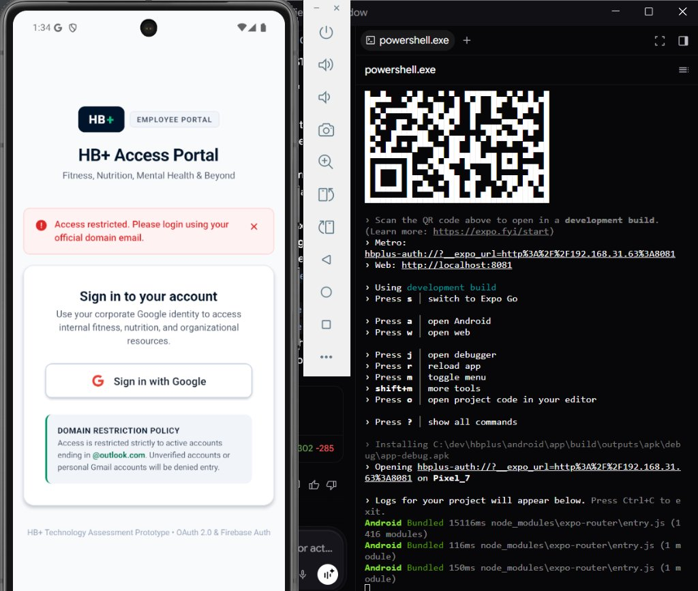
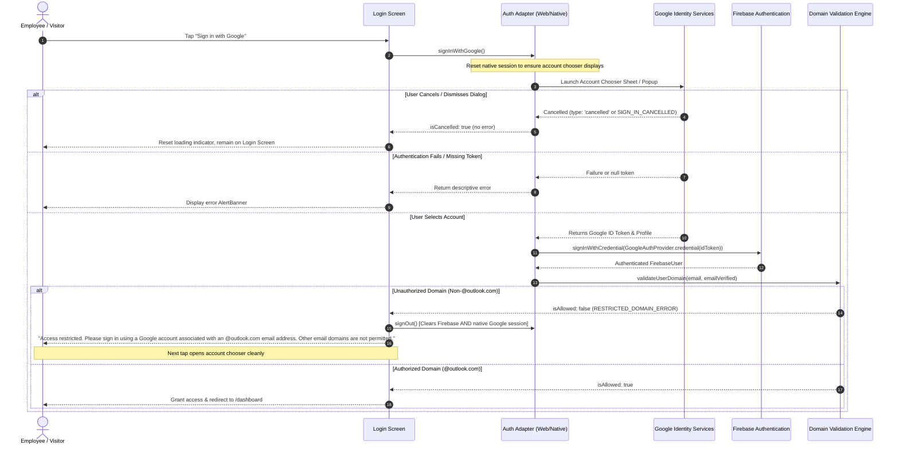

# Employee Access Portal — Cross-Platform Authentication App

[](https://hbplus-auth-assessment.netlify.app)
[](https://expo.dev/accounts/bashisthanayak/projects/hbplus-auth-assessment/builds/22cdb7f3-d860-4b3c-9812-1621eb81ba04)
[](https://github.com/BASHISTHANAYAK/hbplus-auth-assessment)
[](https://www.typescriptlang.org/)
[](https://expo.dev/)
[](https://reactnative.dev/)
[-brightgreen.svg)]()
[%20%7C%20Android%20(Verified)%20%7C%20iOS%20(Untested)-blue.svg)]()

> **Project:** Employee Access Portal (Developer Portfolio Showcase)  
> **Allowed Domain Policy:** `@outlook.com`  
> **Demo Access Requirement:** Sign in using a Google account associated with an `@outlook.com` email address. Other email domains are not permitted.  
> **Live Web Application:** [https://hbplus-auth-assessment.netlify.app](https://hbplus-auth-assessment.netlify.app)  
> **Standalone Android APK:** [https://expo.dev/accounts/bashisthanayak/projects/hbplus-auth-assessment/builds/22cdb7f3-d860-4b3c-9812-1621eb81ba04](https://expo.dev/accounts/bashisthanayak/projects/hbplus-auth-assessment/builds/22cdb7f3-d860-4b3c-9812-1621eb81ba04)  
> **GitHub Repository:** [https://github.com/BASHISTHANAYAK/hbplus-auth-assessment](https://github.com/BASHISTHANAYAK/hbplus-auth-assessment)  
> **Android Build Status:** Completed, installed, and verified on Pixel 7 emulator (API 34)

---

## 1. Overview & Architecture

The **Employee Access Portal** is a production-grade cross-platform authentication prototype demonstrating enterprise Single Sign-On (SSO) using **Google OAuth 2.0** and **Firebase Authentication**. Built with **React Native**, **React Native for Web**, and **Expo Router**, the application shares a single, unified codebase across Web and Android mobile environments.

The portal enforces a strict corporate domain restriction policy: only Google-authenticated identities with a verified email ending in `@outlook.com` are granted access to internal employee resources.

### Application Preview

*Figure: Android Pixel 7 emulator running the Employee Access Portal side-by-side with Expo Metro, showing Google Sign-In and domain rejection enforcement.*

---

## 2. Core Behaviors & Domain Enforcement

### 1. Authorized Access (`user@outlook.com`)
* Authenticated users possessing a verified Google account with an `@outlook.com` email address are granted access to the protected internal dashboard (`/dashboard`).
* The dashboard displays user identity metadata, Google avatar, verified badge, and internal workspace resources.

### 2. Demo Access Requirement & Rejection (`someone@gmail.com` or other domains)
* The login screen prominently communicates the access rule:  
  > **"Demo access: Sign in using a Google account associated with an @outlook.com email address. Other email domains are not permitted."**
* Any non-`@outlook.com` email (e.g., standard personal `@gmail.com` accounts or arbitrary external domains) is immediately denied entry with the matching security error:  
  **`"Access restricted. Please sign in using a Google account associated with an @outlook.com email address. Other email domains are not permitted."`**
* Upon rejection, client tokens are immediately revoked from both Firebase Authentication and the native Google identity provider.

### 3. Seamless Google Account Switching
* On Android, Google Play Services caches the previously authenticated Google account. Without explicit cache invalidation, subsequent taps would auto-select the rejected account in an inescapable loop.
* To guarantee seamless account switching:
  1. The native adapter calls `GoogleSignin.signOut()` directly prior to `GoogleSignin.signIn()`.
  2. When domain validation rejects an email, `authAdapter.signOut()` flushes both Firebase Authentication and native Google Play Services sessions immediately.
  3. Tapping "Sign in with Google" again re-opens the native Google account chooser sheet, allowing the user to select or register a different account.

### 4. Cancellation Handling
* When a user opens the Google account picker and dismisses or cancels it without selecting an account, the app catches library cancellation signals (`isCancelledResponse`, `response.type === 'cancelled'`, and `statusCodes.SIGN_IN_CANCELLED`).
* The loading spinner resets cleanly and the user remains on the login screen with **no false or misleading error alerts**.

---

## 3. Cross-Platform Strategy & Code Sharing

The application shares **100% of UI screens, routing guards, theme tokens, and domain validation logic** across Web and Mobile.

```
                  ┌────────────────────────────────────────┐
                  │       Shared Presentation Layer        │
                  │   src/app (Expo Router Screens)        │
                  │   src/components (Cards, Buttons, ...) │
                  │   src/context/AuthContext.tsx          │
                  │   src/utils/domainValidation.ts        │
                  └───────────────────┬────────────────────┘
                                      │
                         src/services/authService.ts
                                      │
                 ┌────────────────────┴────────────────────┐
                 ▼                                         ▼
   src/services/authAdapter/                 src/services/authAdapter/
      authAdapter.web.ts                        authAdapter.native.ts
  (Firebase Popup Google Auth)             (@react-native-google-signin
                                            + Firebase Credential Exchange)
```

### Platform Adapter Pattern (`src/services/authAdapter/`)
* **Web (`authAdapter.web.ts`)**: Uses Firebase Authentication's browser popup flow (`signInWithPopup`) with `GoogleAuthProvider`.
* **Native Android & iOS (`authAdapter.native.ts`)**: Integrates `@react-native-google-signin/google-signin` to open the native Google Play Services account picker on Android (or native SDK dialog on iOS), then exchanges the verified Google ID token for a Firebase Auth credential (`GoogleAuthProvider.credential(idToken)` & `signInWithCredential`).

---

## 4. Security Architecture & Limitations

> [!IMPORTANT]
> **Client-Side Domain Validation vs. Server-Side Authorization**
> 
> * **Client-Side Scope**: The domain guard in [`src/utils/domainValidation.ts`](./src/utils/domainValidation.ts) manages UI state transitions, protects navigation routes, and immediately tears down unauthorized client-side sessions.
> * **Security Limitation**: Client-side domain validation **does not** constitute production-grade server-side authorization. Client code running on an end-user device or browser cannot be treated as a trusted security boundary.
> * **Production Recommendation**: Any production backend service or database must independently verify the Google ID token or Firebase Auth session cookie on the server (e.g., using the Firebase Admin SDK) and validate the `email` or `hd` (hosted domain) claim before releasing sensitive enterprise records.
> * **Database Rules**: Server-side Cloud Firestore security rules enforcing the allowed domain at the database tier are provided in [`firestore.rules`](./firestore.rules).
> * **Firestore Default State**: Cloud Firestore profile synchronization is **disabled by default** (`EXPO_PUBLIC_ENABLE_FIRESTORE=false`), ensuring the app operates without unhandled database errors when no database instance exists.

---

## 5. Authentication Sequence



---

## 6. Project Structure

```
hbplus-auth-assessment/
├── .env.example               # Template for environment variables
├── .gitignore                 # Git ignore rules (protects credentials and builds)
├── app.json                   # Expo configuration & native app manifest
├── eas.json                   # EAS Build profiles (preview APK, production)
├── firestore.rules            # Server-side Firestore security rules
├── google-services.json       # Google Play Services Android configuration
├── jest.config.js             # Jest & ts-jest test runner configuration
├── netlify.toml               # Netlify build and routing configuration
├── package.json               # Dependencies and scripts
├── tsconfig.json              # TypeScript strict configuration
│
├── __tests__/                 # Comprehensive test suite (27 tests across 3 suites)
│   ├── authCancellation.test.ts # Google Sign-In cancellation, account switching & tokens (10 tests)
│   ├── domainValidation.test.ts # Domain validation, casing & security edge cases (11 tests)
│   └── firestoreService.test.ts # Firestore bypass guard & role assignment tests (6 tests)
│
├── assets/                    # App icons, splash screens, screenshots
│   └── screenshots/           # Application screenshots (Android emulator preview)
├── public/
│   └── _redirects             # Netlify SPA redirect fallback
│
└── src/
    ├── app/                   # Expo Router screens (file-based navigation)
    │   ├── _layout.tsx        # Root layout with SafeAreaProvider, AuthProvider, Stack
    │   ├── index.tsx          # Initial entry router with session detection
    │   ├── login.tsx          # Branded login screen with Google button, callouts & alerts
    │   └── dashboard.tsx      # Protected dashboard screen with user profile & logout
    │
    ├── components/            # Reusable UI components
    │   ├── AlertBanner.tsx    # Accessible error/warning alert banner
    │   ├── BrandHeader.tsx    # Enterprise portal badge & typography
    │   ├── GoogleSignInButton.tsx # Branded Google button with loading spinner
    │   ├── LoadingScreen.tsx  # Centralized loading indicator
    │   ├── StatusBadge.tsx    # Color-coded status & role tags
    │   └── UserProfileCard.tsx# Profile card with photo, verified badge, domain details
    │
    ├── config/                # Environment & SDK configurations
    │   ├── authConfig.ts      # Domain policy, error strings, and display metadata
    │   ├── firebase.native.ts # Native Firebase init with AsyncStorage persistence
    │   ├── firebase.web.ts    # Web Firebase initialization
    │   └── firebase.ts        # Common fallback export
    │
    ├── context/
    │   └── AuthContext.tsx    # React Context managing session state, login, and logout
    │
    ├── services/              # Authentication & database services
    │   ├── authService.ts     # Google OAuth flow orchestration & session restoration
    │   ├── firestoreService.ts# Optional profile sync (disabled by default)
    │   └── authAdapter/       # Platform-specific auth adapter implementation
    │       ├── authAdapter.native.ts # Native GoogleSignin + Firebase credential
    │       ├── authAdapter.web.ts    # Web Firebase popup authentication
    │       ├── authAdapter.ts        # TypeScript adapter fallback
    │       ├── index.ts              # Platform-resolved entry
    │       └── types.ts              # Adapter interfaces & result types
    │
    ├── theme/                 # Design system
    │   ├── colors.ts          # Slate charcoal and emerald vitality palette
    │   ├── spacing.ts         # Paddings, margins, shadows, and border radii
    │   └── typography.ts      # Typography styles
    │
    ├── types/
    │   └── auth.ts            # TypeScript interfaces for users, roles, and auth states
    │
    └── utils/
        └── domainValidation.ts# Strict domain extraction and verification engine
```

---

## 7. Setup and Installation

### Prerequisites
* **Node.js**: v18.x, v20.x, or v22.x LTS (Recommended: v20 LTS)
* **Package Manager**: `npm`
* **Git**

### Installation Steps

```bash
# 1. Clone repository
git clone https://github.com/BASHISTHANAYAK/hbplus-auth-assessment.git
cd hbplus-auth-assessment

# 2. Install dependencies
npm install

# 3. Create .env file from template
cp .env.example .env
```

---

## 8. Environment Variables

Populate `.env` with your Firebase and OAuth configuration:

```ini
# Firebase Web Client Configuration (Firebase Console > Project Settings)
EXPO_PUBLIC_FIREBASE_API_KEY=AIzaSy...
EXPO_PUBLIC_FIREBASE_AUTH_DOMAIN=hbplus-auth-assessment.firebaseapp.com
EXPO_PUBLIC_FIREBASE_PROJECT_ID=hbplus-auth-assessment
EXPO_PUBLIC_FIREBASE_STORAGE_BUCKET=hbplus-auth-assessment.firebasestorage.app
EXPO_PUBLIC_FIREBASE_MESSAGING_SENDER_ID=123456789012
EXPO_PUBLIC_FIREBASE_APP_ID=1:123456789012:web:abcdef...

# Google OAuth Web Client ID (Required for native token verification)
EXPO_PUBLIC_GOOGLE_WEB_CLIENT_ID=your-client-id.apps.googleusercontent.com

# Target Corporate Domain (Default: outlook.com)
EXPO_PUBLIC_ALLOWED_DOMAIN=outlook.com

# Safe Evaluation Whitelist (Optional, development only)
# EXPO_PUBLIC_TEST_ALLOWED_EMAILS=reviewer@gmail.com

# Optional Cloud Firestore toggle (Default: false)
EXPO_PUBLIC_ENABLE_FIRESTORE=false

# Optional Admin Email Whitelist
EXPO_PUBLIC_ADMIN_EMAILS=admin@outlook.com
```

---

## 9. Development & Testing Commands

```bash
# Start local Metro bundler (Web, Android, iOS)
npm start

# Run in Web browser
npm run web

# Run TypeScript type check (Strict Mode - 0 errors)
npm run lint

# Run Jest unit test suites (27 tests across 3 suites)
npm test

# Build production web bundle (Netlify export)
npm run build:web
```

---

## 10. Platform Setup & Verification Status

### Web Platform (Fully Verified)
* **Status**: ✅ **Live & Verified in Production**
* **Live Deployment**: [https://hbplus-auth-assessment.netlify.app](https://hbplus-auth-assessment.netlify.app)
* **Hosting**: Netlify with SPA redirect handling via `public/_redirects`.
* **Auth Method**: Firebase `signInWithPopup` with Google OAuth provider.
* **Firebase Config**: Netlify domain added to Firebase Console &rarr; Authentication &rarr; Settings &rarr; Authorized domains.

---

### Android Platform (Fully Verified)
* **Status**: ✅ **Completed, Installed and Tested**
* **Standalone Preview APK (EAS Build)**: [https://expo.dev/accounts/bashisthanayak/projects/hbplus-auth-assessment/builds/22cdb7f3-d860-4b3c-9812-1621eb81ba04](https://expo.dev/accounts/bashisthanayak/projects/hbplus-auth-assessment/builds/22cdb7f3-d860-4b3c-9812-1621eb81ba04)
* **Auth Method**: `@react-native-google-signin/google-signin` native account sheet exchanging ID token for Firebase credentials.
* **Verified Behaviors**:
  * Native Google Play Services account picker displays on every attempt.
  * Successful Google login with an `@outlook.com` credential grants access to `/dashboard`.
  * External personal Gmail login correctly rejected with the domain restriction alert.
  * Session rejection clears native Google and Firebase state, enabling seamless account selection on the next attempt.
  * Dismissing the account chooser resets the loading state cleanly without showing errors.
  * Logout flushes session persistence and redirects to `/login`.

#### Local Android Setup & Execution
1. Install Android Studio with Android SDK (API 34+), Android SDK Build-Tools, and Google Play Services system image.
2. Ensure `google-services.json` is located in the project root (contains Firebase package `com.hbplus.authportal`).
3. Register your local debug keystore SHA-1 fingerprint in the Firebase Console:
   ```bash
   keytool -list -v -keystore ~/.android/debug.keystore -alias androiddebugkey -storepass android -keypass android
   ```
4. Start an Android emulator with Google Play Services enabled.
5. Run the native development build:
   ```bash
   npx expo run:android
   ```

#### Standalone Android APK Build (EAS)
```bash
# Install EAS CLI
npm install -g eas-cli

# Run standalone preview APK build
npx eas-cli build --platform android --profile preview
```

---

### iOS Platform (Requirements Documented — Untested)

> [!WARNING]
> **iOS Platform Testing Status: UNTESTED / NOT CONFIGURED**
> 
> The codebase shares universal components and platform abstraction for iOS, but **has not been tested on physical iOS devices or iOS simulators** due to development environment constraints (Windows host machine).

#### iOS Setup Requirements for Reviewers with macOS:
1. **Prerequisites**: macOS with Xcode 15+, CocoaPods installed (`sudo gem install cocoapods`).
2. **Firebase iOS App**:
   * In the Firebase Console, register an iOS app with bundle identifier: `com.hbplus.authportal`.
   * Download `GoogleService-Info.plist` and place it in the project root.
3. **URL Scheme**:
   * Add the `REVERSED_CLIENT_ID` from `GoogleService-Info.plist` as a URL scheme in `app.json` or Xcode to support OAuth redirect callbacks.
4. **Execution**:
   ```bash
   # Run on iOS simulator (macOS only)
   npx expo run:ios
   
   # Or build using EAS cloud infrastructure
   npx eas-cli build --platform ios --profile preview
   ```

---

## 11. Verification & Testing Matrix

| Test Scenario | Scope / Environment | Expected Result | Status |
| :--- | :--- | :--- | :---: |
| **Domain Extraction & Security Edge Cases** | Unit Tests (`domainValidation.test.ts`) | Strict domain match, case insensitivity, subdomain spoofing rejection | ✅ **11/11 Passed** |
| **Firestore Bypass Guard** | Unit Tests (`firestoreService.test.ts`) | Skips Firestore when disabled, prevents `(default)` database warnings | ✅ **6/6 Passed** |
| **OAuth Cancellation & Account Switching** | Unit Tests (`authCancellation.test.ts`) | Distinguishes cancel vs token success vs true failure; clears sessions on reject | ✅ **10/10 Passed** |
| **TypeScript Strict Compilation** | Entire Project | Clean compilation with strict typechecking enabled | ✅ **0 Errors** (`tsc --noEmit`) |
| **Production Web Export** | Web (`dist/`) | Bundles cleanly into production assets | ✅ **Passed** (`expo export -p web`) |
| **Hermes Android Bundle Export** | Android (`dist/`) | Bundles modules into Hermes bytecode | ✅ **Passed** (`expo export -p android`) |
| **Unauthorized Domain (`@gmail.com`)** | Web & Android | Denies access, revokes session, displays required error | ✅ **Verified** |
| **Account Switching on Rejection** | Android Native | Clears Google Play Services & Firebase state; re-prompts account chooser | ✅ **Verified** |
| **Positive Authorization Flow (`@outlook.com`)** | Web & Android | Grants dashboard access for authorized Google accounts | ✅ **Verified** |
| **User Cancellation (Dismiss Picker)** | Web & Android | Returns cleanly to login, clears loading, no error shown | ✅ **Verified** |
| **Route Protection & Direct URL Guard** | Web & Android | Unauthenticated visitors to `/dashboard` redirected to `/login` | ✅ **Verified** |
| **Session Restoration** | Web & Android | Re-validates domain on reload before showing dashboard | ✅ **Verified** |
| **Session Termination (Logout)** | Web & Android | Clears auth state, signs out from Firebase & Google, redirects to `/login` | ✅ **Verified** |
| **Standalone Android Preview APK** | EAS Build & Pixel 7 | APK built, downloaded, installed, and validated on emulator | ✅ **Verified** |
| **iOS Native Execution** | iOS Simulator / Device | Native Google Sign-In and dashboard navigation | ⚠️ **UNTESTED** |

---

## 12. Project Links

* **GitHub Repository:** [https://github.com/BASHISTHANAYAK/hbplus-auth-assessment](https://github.com/BASHISTHANAYAK/hbplus-auth-assessment)
* **Live Web Application:** [https://hbplus-auth-assessment.netlify.app](https://hbplus-auth-assessment.netlify.app)
* **Standalone Android APK:** [https://expo.dev/accounts/bashisthanayak/projects/hbplus-auth-assessment/builds/22cdb7f3-d860-4b3c-9812-1621eb81ba04](https://expo.dev/accounts/bashisthanayak/projects/hbplus-auth-assessment/builds/22cdb7f3-d860-4b3c-9812-1621eb81ba04)
